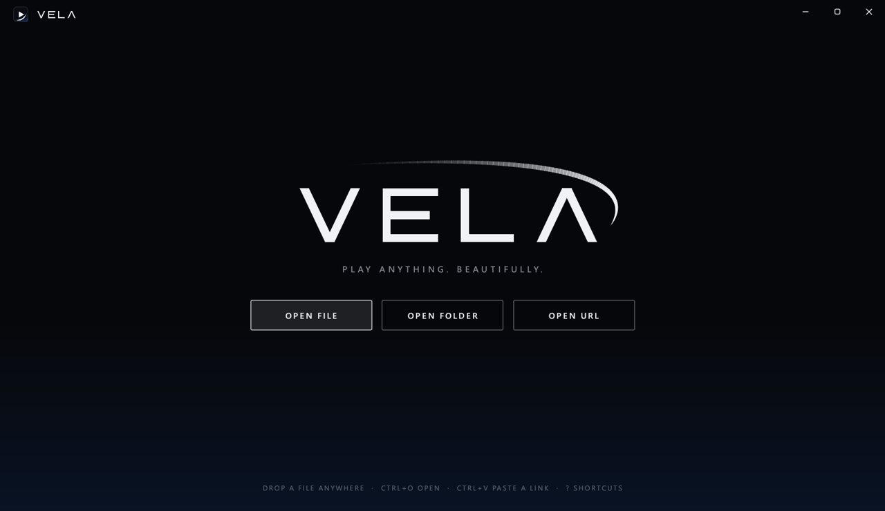
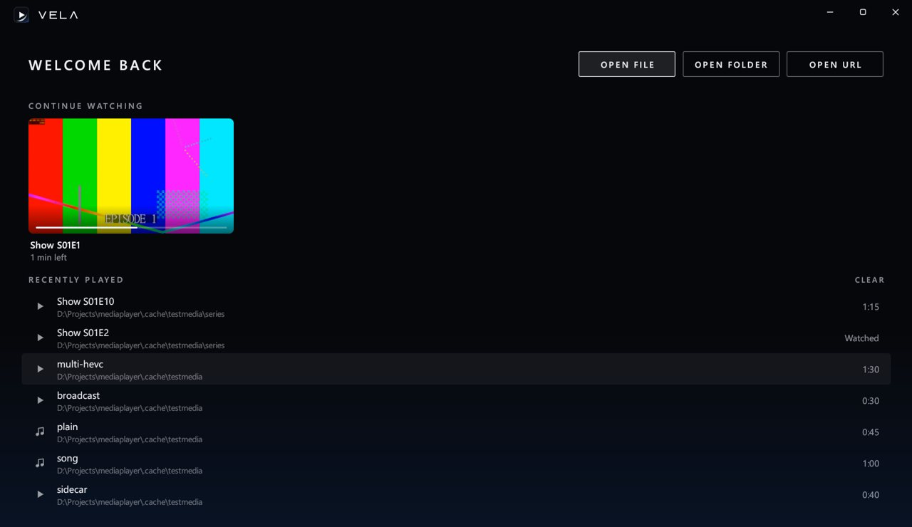
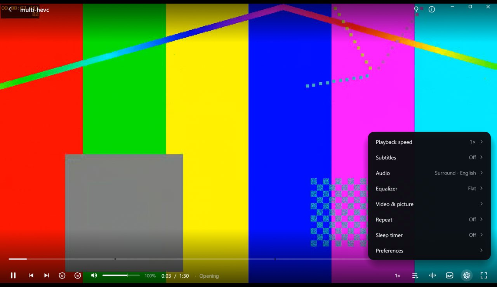
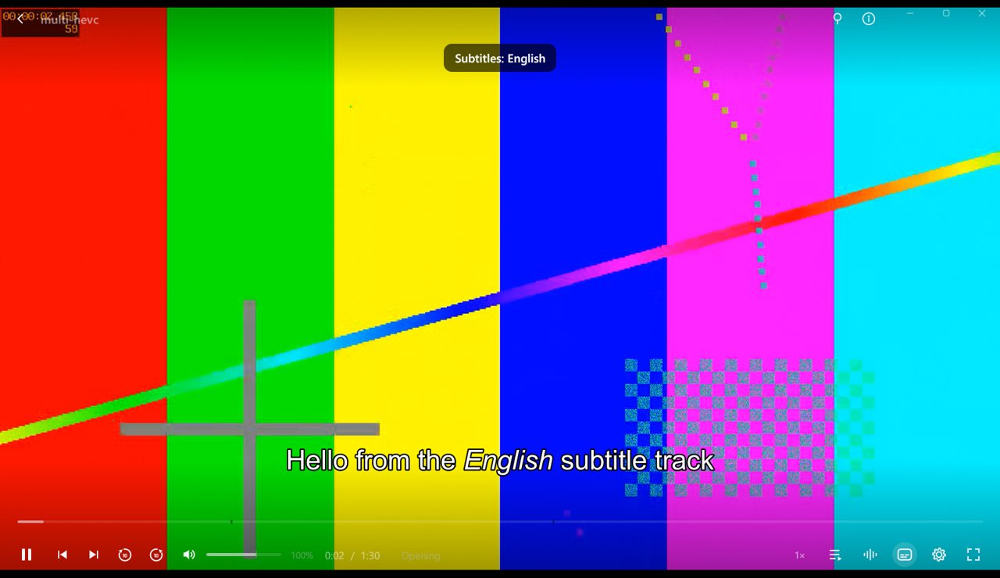

# VELA

**Play anything. Beautifully.** A fast, minimal media player for Windows, macOS and
Linux: a native Rust app on top of **libmpv** (the engine behind mpv and IINA).
It plays virtually every audio and video format with GPU decoding, and its
monochrome overlay UI is drawn on the GPU in the same pass as the video.


| | |
|---|---|
|  |  |
|  |  |

| Measured on Windows (RTX 4060 laptop) | VELA | stock mpv (d3d11) |
|---|---|---|
| App binary | 2.2 MB (+ libmpv) | — |
| Windows installer | 33 MB | — |
| Cold start → window | ~360 ms | — |
| CPU, HEVC 720p playback | **5.6 %** of one core | 9.8 % |
| CPU, paused / idle | ~0.3 % | — |
| RAM idle (after trim) → playing | 16 MB → ~220 MB | 99 → 152 MB |

## Features

- **Plays everything**: MKV, MP4, AVI, MOV, WMV, FLV, TS/M2TS, WebM, OGG, 3GP, VOB…;
  H.264, HEVC (incl. 10-bit), AV1, VP9, MPEG-2/4, XviD, WMV, ProRes; AAC, AC3/E-AC3,
  DTS, TrueHD, FLAC, Opus, MP3…; HTTP/HLS streams (YouTube too with `yt-dlp` on PATH).
- **Frame-exact seeking** with seek-bar **thumbnail previews** and **chapter markers**.
- **Subtitles**: embedded SRT/ASS/PGS/VobSub, auto-loaded sidecar files, load from file
  or drag-drop, delay, size, position, colour, background; lifted above the controls.
- **Audio**: track switching, audio delay, volume boost to 200 %, 10-band equalizer
  with presets, loudness normalisation.
- **Video**: aspect ratio, zoom, rotate, brightness/contrast/saturation/gamma/hue,
  deinterlace, hardware-decoding toggle.
- **Playback**: speed 0.25–4× (pitch-corrected), frame step, A-B repeat, repeat
  file/playlist, shuffle, sleep timer, autoplay next with an "Up next" card.
- **Home**: continue watching (with poster frames), recently played, resume where you
  left off.
- **OS integration**: "Open with" and right-click "Play with VELA" (Windows), Finder
  "Open With" (macOS), file-manager "Open With" via the `.desktop` file (Linux); single
  instance (multi-select becomes one sorted playlist), drag-and-drop, always-on-top,
  keeps the screen awake while playing, screenshots to `Pictures/VELA`.

### Keyboard (⌘ instead of Ctrl on macOS)

Space/K play · ←/→ 5 s · J/L 10 s · Shift+←/→ 1 min · Ctrl+←/→ chapter · 0–9 jump to % ·
,/. frame step · ↑/↓/wheel volume · M mute · [ ] speed · Backspace normal speed ·
F/Enter/double-click fullscreen · C subtitles · V next subtitle · G/H subtitle delay ·
B next audio track · A aspect · N/P next/previous · R repeat · S screenshot ·
T always on top · I stats · Ctrl+O open · Ctrl+V paste link/path · ? all shortcuts

## Architecture

```
winit window ─► glutin GL context (WGL / CGL / EGL·GLX) ─► libmpv render API draws the frame
                                                         └► egui draws the overlay ─► swap
```

- `src/mpv.rs`: hand-written libmpv FFI (client + render API), no binding crate.
- `src/app.rs`: window, render loop, input, timers, IPC. Frames are rendered **only**
  when mpv has a new picture or the UI changed.
- `src/ui.rs`: the whole UI, including the vector logo and wordmark. No image assets.
- `src/thumbs.rs`: a headless second libmpv renders keyframes (software renderer) for
  seek previews and posters, and shuts itself down after 12 s idle.
- `src/platform.rs`, `src/fonts.rs`, `src/ipc.rs`, `src/macos.rs`: the OS-specific parts
  (named pipe vs Unix socket, keep-awake, fonts, Finder open events).
- `build.rs`: links libmpv; on Windows it also emits the icon, version info and DPI
  manifest as a COFF resource object directly, so no resource compiler is needed.
- `scripts/brand.py`: renders the icon (`.ico`, `.png`) and wordmark from the same
  geometry the app draws.

## Build

| OS | Needs | Command | Output |
|---|---|---|---|
| Windows | Python 3, NSIS | `.\build.ps1 -Setup` (first time), then `.\build.ps1` | `dist\VELA-Setup-1.0.0.exe`, portable zip |
| Linux | `libmpv-dev`, `cargo install cargo-deb` | `bash packaging/linux/build.sh` | `.deb` + tarball with `install.sh` |
| macOS | `brew install mpv dylibbundler` | `bash packaging/macos/bundle.sh` | `VELA.app` in a `.dmg` |

`.github/workflows/release.yml` builds all three on GitHub's machines and attaches them
to a release when you push a `v*` tag.

## Tests

```bash
python scripts/make_test_media.py          # synthetic library in .cache/testmedia (needs ffmpeg)
python scripts/test_features.py target/release/vela.exe .cache/testmedia out
```

85 end-to-end checks: the script drives the real app through its automation channel
(`scripts/cv.py`), verifies mpv's actual state after each action and screenshots
every UI state. `scripts/test_real_input.ps1` additionally drives the window with real
mouse/keyboard input on Windows. Run it only when you're not using the PC.

## Shipping notes

- **Code signing**: unsigned builds get "Windows protected your PC" from SmartScreen,
  and Smart App Control blocks them outright; macOS Gatekeeper blocks unsigned,
  un-notarized apps. Linux doesn't gate apps this way. Options: SignPath Foundation
  (free for open source), Azure Trusted Signing, a code-signing certificate, or the
  Microsoft Store on Windows; an Apple Developer ID plus notarization on macOS.
  `build.ps1` signs automatically when `VELA_SIGN` is set; `bundle.sh` signs and
  notarizes when `MACOS_SIGN_IDENTITY` / `MACOS_NOTARY_PROFILE` are set.
- **Licensing**: the bundled libmpv build is GPL-2.0+, so distributing VELA with it
  means complying with the GPL (publish your source, or switch to an LGPL libmpv
  build). See `installer/THIRD-PARTY-NOTICES.txt`.
- **Name**: check trademarks for "VELA" in your markets before a public launch.
